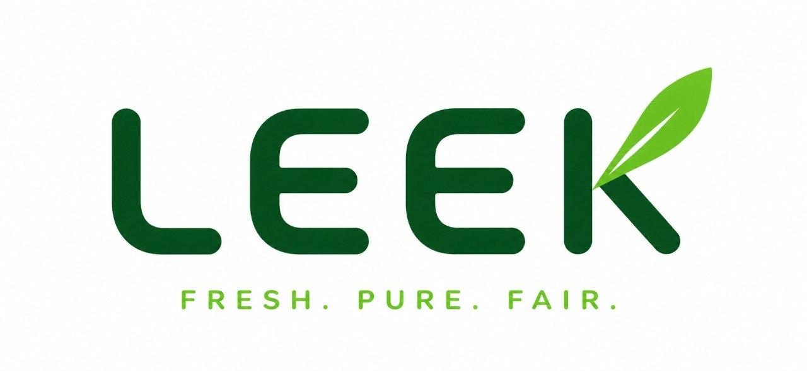
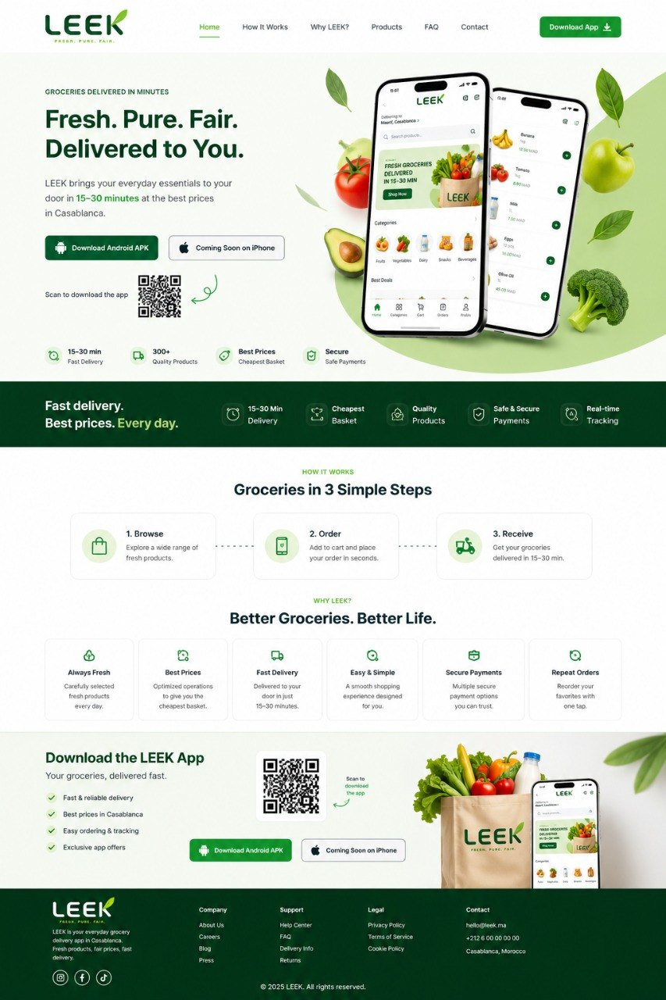

# LEEK — Website

> **Groceries delivered in minutes.** LEEK brings your everyday essentials to your door in **15–30 minutes** at the best prices

This repository contains the **page website** for **LEEK**, a quick-commerce grocery delivery app. The site explains how the service works, and drives visitors to download the mobile app

---

## About the Project

**LEEK** is a grocery delivery platform that connects people with fresh, quality products without the hassle of going to the store. Customers browse a wide catalog, place an order in seconds, and receive it at their door in 15–30 minutes

The mission is simple: **fresh products, fair prices, fast delivery**

### What LEEK Does

- 🛒 **Browse** a wide range of fresh products: fruits, vegetables, dairy, snacks, beverages, and more
- 📱 **Order** in seconds by adding items to the cart and placing the order from the app
- 🛵 **Receive** your groceries in **15–30 minutes**
- 📍 **Track** your order in real time
- 🔁 **Reorder** your favorites with one tap

### Context

Everyday grocery shopping in large cities costs time, and prices are often inconsistent. LEEK addresses this with optimized operations that allow it to offer the **cheapest basket** in Casablanca while keeping products carefully selected and fresh. Customers pay securely through multiple payment options

---

## Website Sections

| Section | Description |
|---|---|
| **Header / Navbar** | Logo, navigation (Home, How It Works, Why LEEK?, Products, FAQ, Contact) and a *Download App* button |
| **Hero** | Headline "Fresh. Pure. Fair. Delivered to You.", app mockups, Android APK download, iPhone "Coming Soon", and a QR code |
| **Quick Stats** | 15–30 min delivery, 300+ quality products, best prices, secure payments |
| **Value Banner** | "Fast delivery. Best prices. Every day." with key highlights |
| **How It Works** | 3 simple steps: Browse → Order → Receive |
| **Why LEEK?** | Always Fresh, Best Prices, Fast Delivery, Easy & Simple, Secure Payments, Repeat Orders |
| **Download CTA** | App benefits, QR code, store buttons, and app mockup |
| **Footer** | Company, Support, Legal, Contact links and social icons (Instagram, Facebook, TikTok) |

---

## Design

- **Style:** Clean, modern, fresh, with generous whitespace and rounded cards
- **Palette:** Deep forest green (`#0B3D1E` range), vibrant leaf green (`#2E9E3F` range), light mint backgrounds, white surfaces
- **Imagery:** Fresh produce, app mockups, paper grocery bag
- **Layout:** Responsive, mobile-first
- **Tagline:** *Fresh. Pure. Fair.*

---

## Tech Stack

- **[Next.js](https://nextjs.org/)** (App Router)
- **TypeScript**
- **React**
- **Tailwind CSS** via PostCSS
- **ESLint** for linting

---

## 🤝 Contributing

Contributions, issues, and feature requests are welcome. Feel free to open an issue or submit a pull request

1. Fork the project
2. Create your branch (`git checkout -b feature/amazing-feature`)
3. Commit your changes (`git commit -m "Add amazing feature"`)
4. Push to the branch (`git push origin feature/amazing-feature`)
5. Open a Pull Request

---

## 📄 License

© LEEK. Walid Hattaoui.
